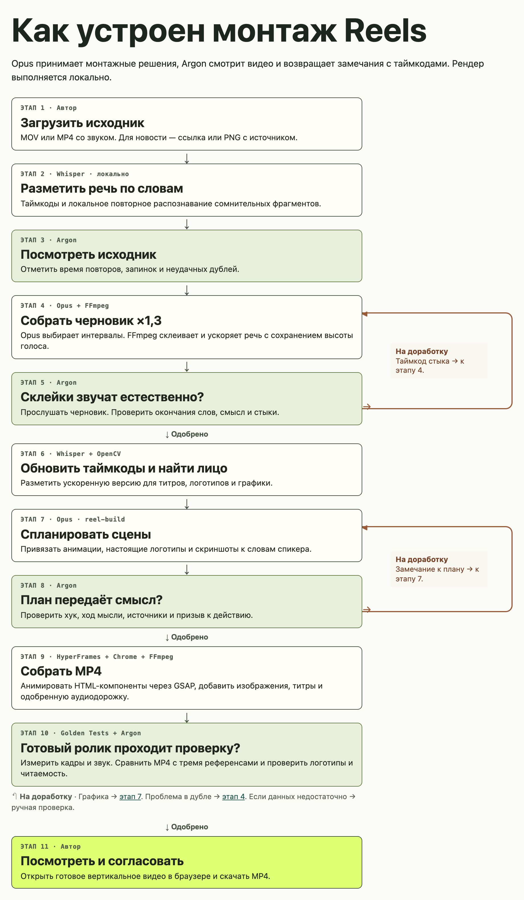

# Монтаж App 4 Wheels

Приложение монтирует вертикальные ролики на вашем компьютере: вы загружаете видео и получаете черновик без длинных пауз.
В полном режиме две ИИ-модели ещё выбирают дубли, добавляют титры, анимации и логотипы.

Так проходит полный монтаж:

<a href="docs/pipeline.png"></a>

## Бесплатное демо

Ключи и оплата не нужны, расход на API – 0.

1. Установите Python 3.12 или новее и FFmpeg (вместе с ffprobe). Приложение рассчитано на macOS, проще всего поставить через [Homebrew](https://brew.sh): `brew install python ffmpeg`. Проверьте версию: `python3 --version`.
2. Скачайте проект и перейдите в его папку:

   ```sh
   git clone https://github.com/qwwiwi/montazh-app-4-wheels.git
   cd montazh-app-4-wheels
   ```

3. Запустите приложение и не закрывайте это окно терминала:

   ```sh
   python3 app/server.py --port 8774
   ```

4. Откройте http://127.0.0.1:8774 и нажмите «Попробовать на примере». Справа появится готовый ролик.

Пример – это тестовая картинка с тремя сигналами и паузами между ними, без речи. На нём видно, как приложение сокращает паузы. Свою запись можно загрузить там же в режиме «Черновик по паузам». Остановить приложение – Ctrl+C.

## Полный режим

Полный режим платный: нужен свой ключ [OpenRouter](https://openrouter.ai). На один ролик приложение тратит **не больше $2**, включая повторные попытки и доработки. Пример расчёта – в [docs/COST.md](docs/COST.md).

Расшифровки и видео со звуком, включая референсы, отправляются в OpenRouter. Распознавание речи и сборка ролика идут на вашем компьютере.

1. Установите Git, Google Chrome, Node.js с npm и Python 3.12 (`brew install python@3.12`). Затем из папки проекта выполните:

   ```sh
   npm install -g hyperframes@0.9.17
   python3.12 -m venv skills/reel-build/.venv
   skills/reel-build/.venv/bin/python -m pip install -r skills/reel-build/requirements.txt
   npm ci --prefix skills/reel-build
   python3 assets/official-media/fetch.py
   python3 app/prepare_libraries.py
   ```

   Последняя команда скачивает библиотеки графики и логотипов в папку `reel-libraries` рядом с папкой проекта.

2. Положите три разных видео, которые вы вправе использовать как образцы монтажа (референсы), в файлы `references/A.mp4`, `references/B.mp4` и `references/C.mp4`. Папку `references` создайте сами.
3. Сохраните ключ в файл, который можете читать только вы. Заведите для приложения отдельный ключ.

   ```sh
   mkdir -p ~/.config/montazh-app-4-wheels
   nano ~/.config/montazh-app-4-wheels/openrouter.key
   chmod 600 ~/.config/montazh-app-4-wheels/openrouter.key
   ```

   В редакторе вставьте ключ одной строкой, сохраните (Ctrl+O, Enter) и выйдите (Ctrl+X). Не добавляйте ключ в файлы проекта.

4. Перезапустите приложение, выберите «Opus + Gemini · по референсам» и загрузите запись. Если режим недоступен, под списком будет написано, чего не хватает. При первом распознавании речи нужен интернет: скачиваются веса Whisper.

Дополнительно:

- Другое расположение: `REEL_KEY_FILE` – путь к файлу с ключом (права 0600), `REEL_REFERENCE_DIR` – папка с референсами. Вместо файла ключ можно передать переменной `REEL_OPENROUTER_API_KEY`.
- Недельный предел расходов задаётся переменной `REEL_WEEKLY_LIMIT_USD`.
- Чтобы показать в ролике сайт или новость, приложите PNG, ссылку на источник и фразу из речи. Для статьи Хабра достаточно прямой ссылки, например на [статью Selectel с графиками](https://habr.com/ru/companies/selectel/articles/1109880/).
- Графика amoCRM и сведения о логотипах – в [assets/official-media/README.md](assets/official-media/README.md). Набор amoCRM готовьте до команды `python3 app/prepare_libraries.py`.

## Схема и критерии приёмки

- [pipeline.html](pipeline.html) – интерактивная схема. Скачайте файл (на GitHub кнопка «Download raw file») и откройте в браузере. В запущенном приложении она открывается по ссылке «Как устроен монтаж».
- [docs/GOLDEN.md](docs/GOLDEN.md) – по каким критериям принимается готовый ролик (на английском).

## Что где лежит

| Путь | Что внутри |
|---|---|
| `app/` | Код приложения: сервер и этапы монтажа |
| `assets/` | Тестовый ролик `demo.mp4` и скрипты для логотипов |
| `docs/` | Картинка схемы, критерии приёмки, расчёт стоимости |
| `skills/` | Скилл reel-build: титры, анимации, сборка ролика |
| `tests/` | Автоматические проверки приложения |
| `index.html` | Страница приложения, открывается через сервер |
| `pipeline.html` | Интерактивная схема монтажа |

При работе появится папка `jobs/` – ваши видео, временные файлы и журналы расходов. Она остаётся на компьютере и не попадает в Git.

Если вы скачали проект раньше: приложение теперь запускается командой `python3 app/server.py`. Для полного режима заново выполните две последние команды из шага 1, а если пользовались графикой amoCRM – и `python3 assets/official-media/prepare-amocrm.py` перед ними. Оставшуюся старую папку `official-media/` можно удалить.

## Проверки для разработчиков

Нужны зависимости из шага 1 полного режима. Запускайте из папки проекта:

```sh
python3 -m unittest discover -v
skills/reel-build/.venv/bin/python -m pytest -q skills/reel-build/tests
```

## Интеграции

Модели подключаются через OpenRouter. Сервер принимает запросы только с этого компьютера; внешний доступ, например через обратный прокси OpenResty, настраивается отдельно. Подключение Kie AI – возможное расширение: [открыть Kie AI (партнёрская ссылка проекта)](https://kie.ai?ref=7ded43718fbb6e70658c259b12abf2d6).
